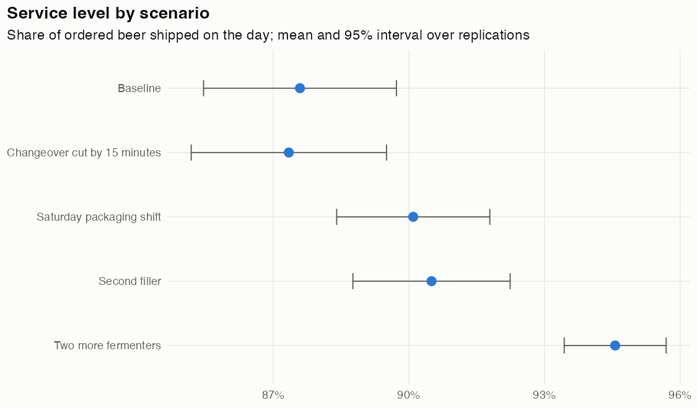

# Comparison of scenarios

*Written by `R/run.R --compare`; do not edit by hand. Synthetic plant.*

| Scenario | Changes | Service level (95% interval) | vs Baseline (paired 95% interval) | Packaged hL/yr | Back orders at year end (hL) | Fermenters active | Filler occupied | Plan blocked by full tanks | Bottleneck | Runtime (s) |
|---|---|---|---|---|---|---|---|---|---|---|
| [[Baseline]] | none | **87.6%** (85.5% to 89.7%) |  | 268,806 | 0 | 91% | 86% | 41% | Fermenters | 3 |
| [[Changeover cut by 15 minutes]] | Changeovers.format_change.value = 45; Changeovers.product_change.value = 15 | **87.3%** (85.2% to 89.5%) | -0.2 pts (-1.0 to +0.5) | 268,653 | 0 | 91% | 84% | 41% | Fermenters | 3 |
| [[Saturday packaging shift]] | Shifts.calendars.packaging.days = Mon/Tue/Wed/Thu/Fri/Sat | **90.1%** (88.4% to 91.8%) | +2.5 pts (+1.7 to +3.3) | 267,239 | 0 | 91% | 71% | 39% | Fermenters | 3 |
| [[Second filler]] | Filler.capacity = 2; Labeller and packer.capacity = 2; Palletiser.capacity = 2 | **90.5%** (88.8% to 92.2%) | +2.9 pts (+2.1 to +3.7) | 266,609 | 0 | 92% | 44% | 40% | Fermenters | 3 |
| [[Two more fermenters]] | Fermenters.capacity = 24 | **94.6%** (93.4% to 95.7%) | +7.0 pts (+5.5 to +8.5) | 268,921 | 0 | 83% | 86% | 21% | Filler | 3 |

Replication *r* of every scenario starts from the same random seed as replication *r* of the Baseline (common random numbers), so the change versus Baseline is measured pair by pair. Its interval is much narrower than the two scenarios' own intervals; a change whose paired interval spans zero is not distinguishable from noise.
