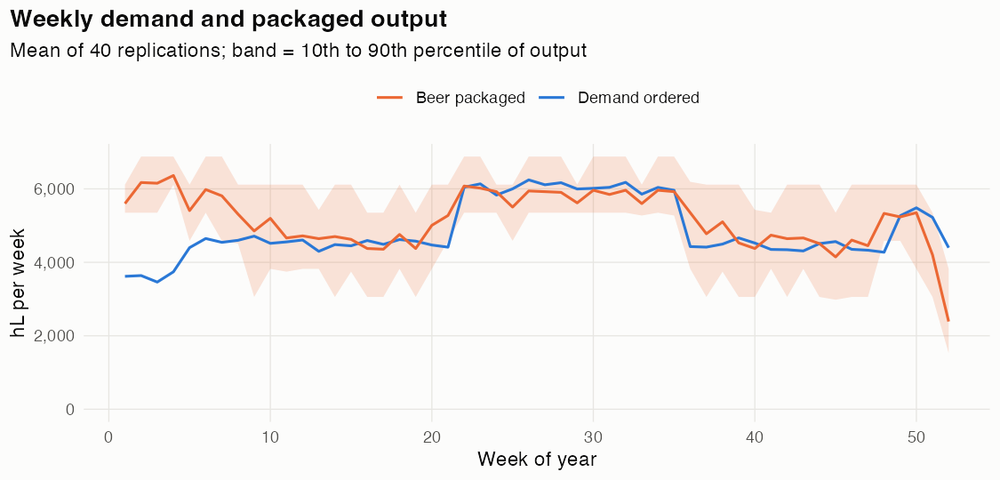
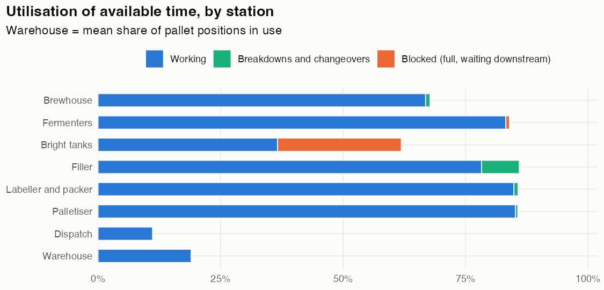
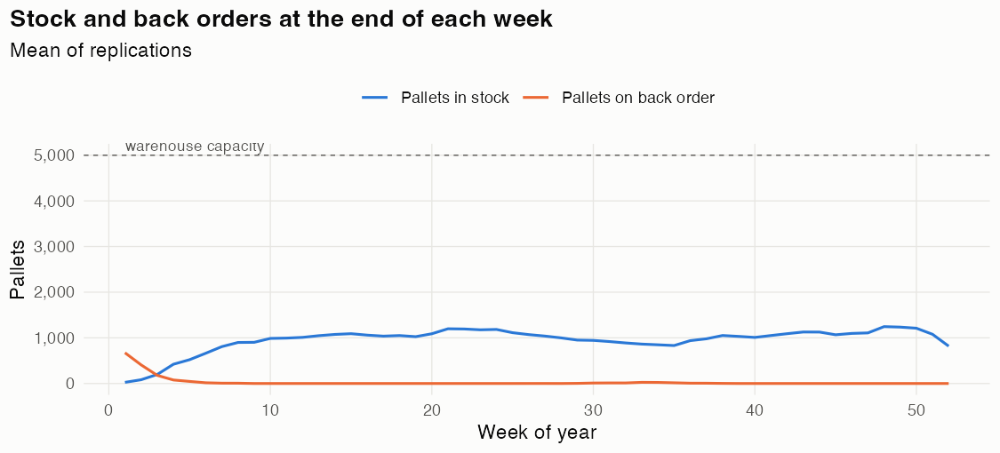
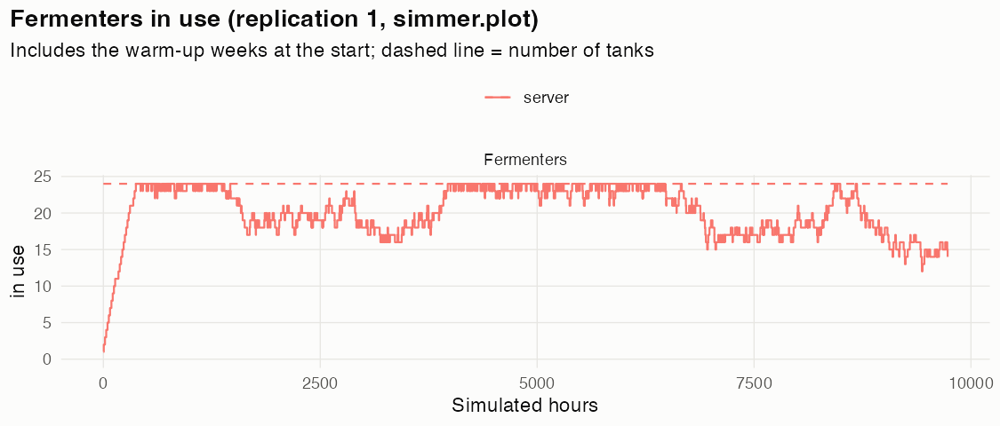

# Results: Two more fermenters

*Written by `R/run.R`; do not edit by hand. Synthetic plant: every input is an illustrative assumption or a rule of thumb.*

> **Question:** Would two more fermenters fix our summer shortfalls?

## Headline

Service level **94.6%** (95% interval 93.4% to 95.7%) of 253,969 hL ordered. The bottleneck is **Filler** (86% of its available time in use, excluding time spent blocked); next tightest is Fermenters at 83%. For 21% of the year's hours the production plan wanted to brew but every fermenter was full.

## Changes from the plant notes

- `Fermenters.capacity` = 24

## Throughput and demand (measured year)

| Measure | Mean | 95% interval |
|---|---|---|
| Demand ordered (hL) | 253,969 | 252,439 to 255,500 |
| Beer packaged (hL) | 268,921 | 267,438 to 270,404 |
| Packaged / ordered | 105.9% | |
| Service level (share shipped on the day ordered) | 94.6% | 93.4% to 95.7% |
| Back orders at year end (hL) | 0 | 0 to 0 |
| Fermenter fills packaged | 352 | |
| Hours the plan wanted beer but all fermenters were full | 21% | 19% to 23% |
| Changeover hours on the filler | 209 | |

## Utilisation per station

Share of each station's *available* time (on shift, all units) that it was occupied. **Active** excludes time a tank sat full waiting for the next step, which is a symptom of a constraint downstream, not work. Queue is the time-averaged number of batches (or trucks) waiting; wait is the mean hours a batch waited to get in.

| Station | Units on shift (mean) | Occupied | Blocked | Breakdowns + changeovers | Active | Mean queue | Mean wait (h) |
|---|---|---|---|---|---|---|---|
| Brewhouse | 0.9 | 68% | 0% | 1% | **68%** | 0.26 | 5.3 |
| Fermenters | 24.0 | 84% | 1% | 0% | **83%** | 0.00 |  |
| Bright tanks | 6.0 | 62% | 25% | 0% | **37%** | 0.18 | 4.3 |
| Filler | 0.5 | 86% | 0% | 8% | **86%** | 1.94 | 37.0 |
| Labeller and packer | 0.5 | 86% | 0% | 1% | **86%** | 0.41 |  |
| Palletiser | 0.5 | 86% | 0% | 0% | **86%** | 0.41 |  |
| Dispatch | 0.9 | 11% | 0% | 0% | **11%** | 0.16 |  |
| Warehouse | 5,000 pallet positions | 19% | 0% | 0% | **19%** |  |  |

## How to read the bottleneck

The bottleneck is the station with the highest *active* utilisation. The packaging line (filler, labeller and packer, palletiser) runs as one unit, so the three machines show nearly the same figure; the filler paces it. Wait at Bright tanks is the time beer sat in a full fermenter waiting for a bright tank; wait at the filler is the time beer sat in a bright tank waiting for the line.

Runtime: 2.5 s for 40 replications. Raw numbers: `Results/data/two-more-fermenters.csv` and `two-more-fermenters-replications.csv`.
